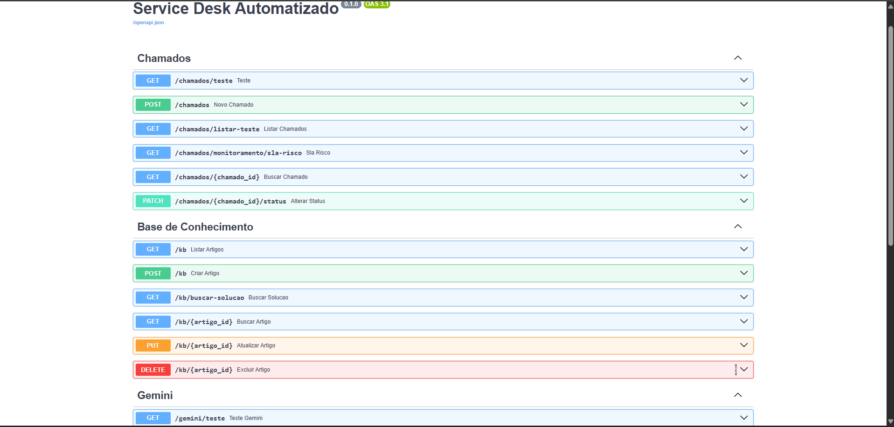
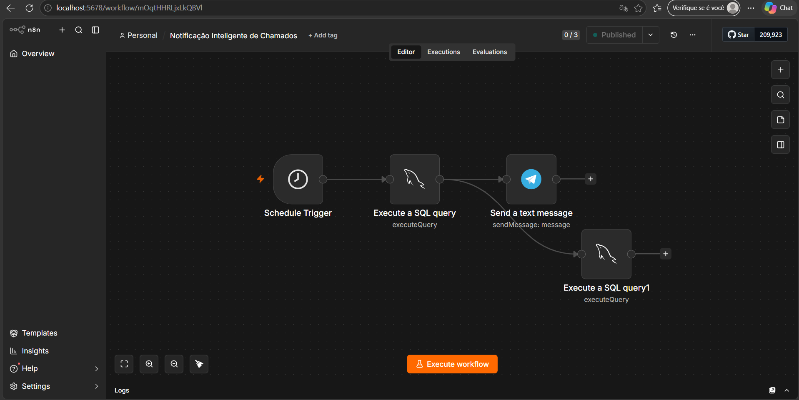
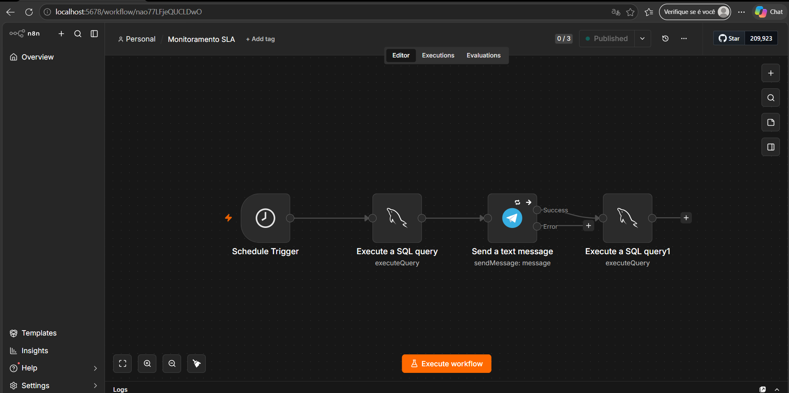
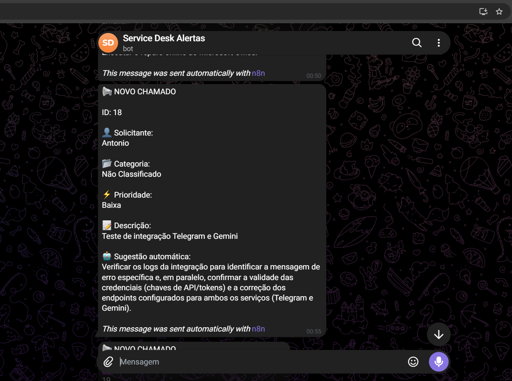
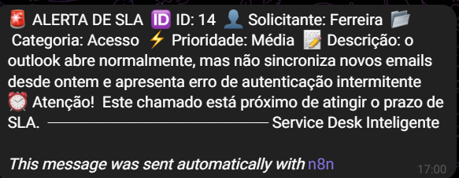

# 🚀 Service Desk Inteligente

Sistema de Service Desk desenvolvido com FastAPI, MySQL, Google Gemini, n8n e Telegram para automação de chamados, monitoramento de SLA e geração automática de sugestões de solução.

---

# 📋 Funcionalidades

✅ CRUD de Chamados

✅ Histórico de Chamados

✅ Alteração de Status

✅ Classificação Automática

✅ Prioridade Automática

✅ SLA Automático

✅ Monitoramento de SLA

✅ Base de Conhecimento

✅ Busca Inteligente de Soluções

✅ Integração com Google Gemini

✅ Sugestão Automática por IA

✅ Integração com MySQL

✅ Integração com n8n

✅ Integração com Telegram

✅ Controle de Alertas Duplicados

✅ Controle de Notificações Duplicadas

✅ Logs e Tratamento de Erros

---

# 🏗️ Arquitetura

```text
Usuário
    ↓
FastAPI
    ↓
Classificação Automática
    ↓
Prioridade Automática
    ↓
Base de Conhecimento
    ↓
Gemini (quando necessário)
    ↓
MySQL
    ↓
n8n
    ↓
Telegram
```

---

# 🧰 Tecnologias Utilizadas

- Python 3.13
- FastAPI
- SQLAlchemy
- MySQL
- Pydantic
- Google Gemini API
- n8n
- Telegram Bot API
- Uvicorn

---

# 📚 Base de Conhecimento + IA

Fluxo híbrido implementado:

```text
Novo Chamado
       ↓
Busca na Base de Conhecimento
       ↓
Encontrou solução?
    ↓            ↓
   SIM          NÃO
    ↓            ↓
 Usa KB      Consulta Gemini
    ↓            ↓
 Sugestão Final
       ↓
 Salva no Chamado
```

---

# 📸 Swagger



---

# 🤖 Workflow de Notificação Inteligente

Workflow responsável por detectar novos chamados e enviar notificações automáticas para o Telegram.



---

# 🚨 Workflow de Monitoramento de SLA

Workflow responsável por monitorar chamados próximos do vencimento do SLA e alertar automaticamente no Telegram.



---

# 📱 Notificação de Novo Chamado

Exemplo de mensagem gerada automaticamente contendo sugestão produzida pela Base de Conhecimento ou Gemini.



---

# ⏰ Alerta de SLA

Exemplo de alerta enviado automaticamente quando um chamado está próximo de atingir o prazo de SLA.



---

# ⚙️ Instalação

Clone o repositório:

```bash
git clone https://github.com/SEU-USUARIO/service-desk-inteligente.git
```

Acesse a pasta:

```bash
cd service-desk-inteligente
```

Crie o ambiente virtual:

```bash
python -m venv .venv
```

Ative:

Windows:

```bash
.venv\Scripts\activate
```

Instale as dependências:

```bash
pip install -r requirements.txt
```

---

# 🔑 Configuração

Crie um arquivo:

```text
.env
```

Baseado em:

```text
.env.example
```

Exemplo:

```env
DB_HOST=localhost
DB_PORT=3306
DB_USER=root
DB_PASSWORD=sua_senha
DB_NAME=service_desk

GEMINI_API_KEY=sua_chave_aqui
```

---

# ▶️ Executando

```bash
uvicorn app.main:app --reload
```

Swagger:

```text
http://127.0.0.1:8000/docs
```

---

# 🔮 Roadmap

- Interface Web (Frontend)
- Dashboard Gerencial
- Métricas de Atendimento
- Dashboard Power BI
- Autenticação de Usuários
- Integração com Microsoft Teams
- Pesquisa Semântica Avançada
- RAG com Base de Conhecimento

---

# 👨‍💻 Autor

Antonio Denilson Ferreira Araujo

Projeto desenvolvido para estudos de automação, inteligência artificial aplicada a Service Desk e integração de sistemas corporativos.